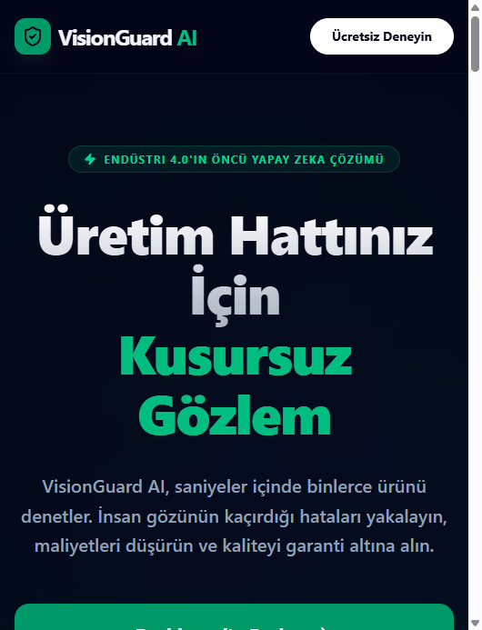
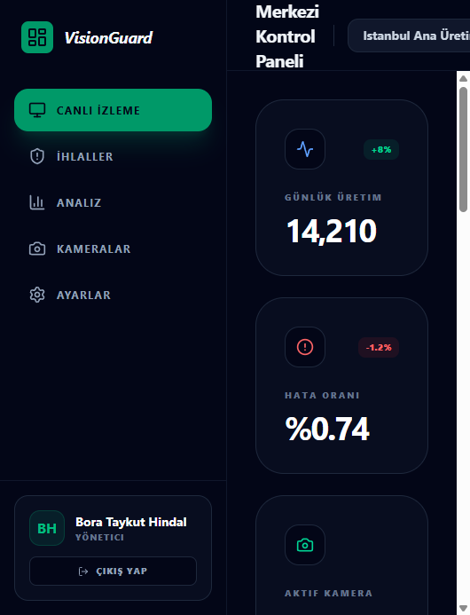
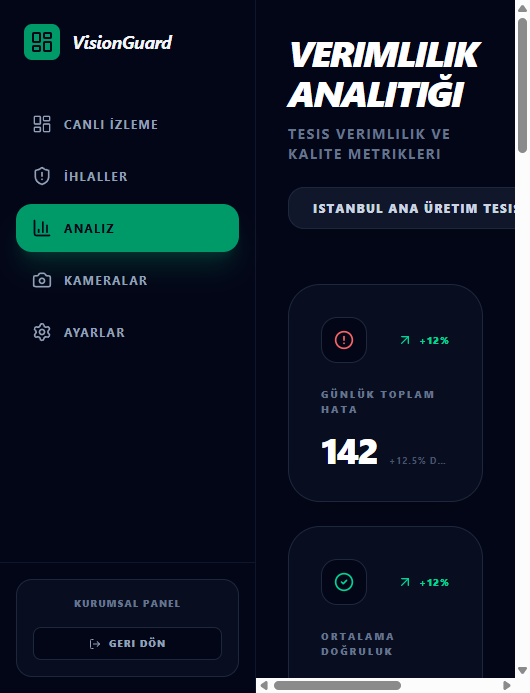
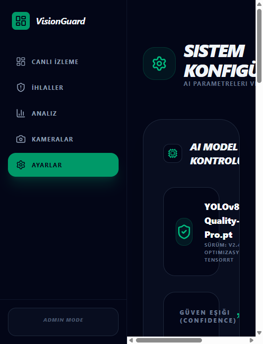

# VisionGuard AI

[](https://3000-in4y5434vnqcnosolqsf2.app.cto.new/)
[](https://docs.convex.dev/)
[](LICENSE)

**VisionGuard AI** is a full-stack industrial quality-control and safety-monitoring platform demo. It showcases real-time defect detection, occupational safety (EHS) alerts, and production analytics for manufacturing lines—built with a modern React frontend and a Convex real-time backend.

> **Note:** This repository is a **demonstration UI** with simulated detections. It is not a production ML inference pipeline.

## Live demo

**[Open the live app →](https://3000-in4y5434vnqcnosolqsf2.app.cto.new/)**

| Page | URL |
|------|-----|
| Landing | [/](https://3000-in4y5434vnqcnosolqsf2.app.cto.new/) |
| Dashboard | [/dashboard](https://3000-in4y5434vnqcnosolqsf2.app.cto.new/dashboard) |
| Analytics | [/analytics](https://3000-in4y5434vnqcnosolqsf2.app.cto.new/analytics) |
| Settings | [/settings](https://3000-in4y5434vnqcnosolqsf2.app.cto.new/settings) |

On the **Settings** page, use **Start simulation** to stream mock detections into the dashboard event log.

## Screenshots

### Landing page



### Central control panel



### Productivity analytics



### System configuration



## Features

- **Marketing landing page** — product positioning, sector solutions, and pricing tiers
- **Live monitoring dashboard** — factory switcher, camera status, KPI cards, and recent detections
- **Analytics** — defect trends, category breakdown, and archive records (Recharts)
- **Settings** — AI model controls, notification channels, and data management UI
- **Demo simulation** — scheduled random detections (defects, safety violations, count errors)
- **Real-time data** — Convex backend with TanStack Query (`useSuspenseQuery` + `convexQuery`)

## Tech stack

| Layer | Technology |
|-------|------------|
| Framework | [TanStack Start](https://tanstack.com/start) + [TanStack Router](https://tanstack.com/router) |
| UI | React 19, Tailwind CSS v4, Framer Motion, Lucide icons |
| Charts | Recharts |
| Backend | [Convex](https://convex.dev/) |
| Language | TypeScript |

## Project structure

```
├── convex/              # Schema, queries, mutations, demo simulation
│   ├── schema.ts        # factories, cameras, detections, users
│   ├── demo.ts          # Live detection simulation
│   ├── seed.ts          # Sample factory & cameras
│   ├── factories.ts
│   ├── cameras.ts
│   └── detections.ts
├── src/
│   ├── routes/          # File-based routes
│   │   ├── index.tsx    # Landing page
│   │   ├── dashboard.tsx
│   │   ├── analytics.tsx
│   │   └── settings.tsx
│   └── router.tsx       # Convex + React Query + Router setup
└── docs/screenshots/    # README assets
```

## Getting started

### Prerequisites

- **Node.js** 20+
- **npm**
- A [Convex](https://convex.dev/) project (run `npx convex dev` to create one)

### Installation

```bash
git clone https://github.com/Taykuth/visionguard-ai.git
cd visionguard-ai
npm install
```

### Environment

Copy the example env file and set your Convex deployment URL:

```bash
cp .env.example .env.local
```

```env
VITE_CONVEX_URL=https://your-deployment.convex.cloud
```

### Development

```bash
npm run dev
```

Open [http://localhost:3000](http://localhost:3000).

### Seed demo data

Run the `seed:seed` mutation once (via the Convex dashboard or CLI) to populate a sample factory, cameras, and initial detections.

### Production build

```bash
npm run build
npm start
```

## Available scripts

| Command | Description |
|---------|-------------|
| `npm run dev` | Start Vite + Convex in development |
| `npm run build` | Production build + typecheck |
| `npm run lint` | ESLint + TypeScript |
| `npm run format` | Prettier |

## Data model

| Table | Purpose |
|-------|---------|
| `factories` | Manufacturing sites (name, location) |
| `cameras` | Per-factory streams with online/offline status |
| `detections` | AI events: type, confidence, severity, status |
| `users` | Roles: `admin`, `operator`, `viewer` |

Detection types include `defect`, `safety_violation`, `count_error`, and more.

## Roadmap

- [ ] Real camera RTSP / WebRTC integration
- [ ] Authentication (Convex Auth) and multi-tenant access
- [ ] PDF / CSV report export
- [ ] English UI (i18n)

## License

This project is licensed under the [MIT License](LICENSE).

## Acknowledgments

Built with [TanStack Start](https://tanstack.com/start) and [Convex](https://convex.dev/).
